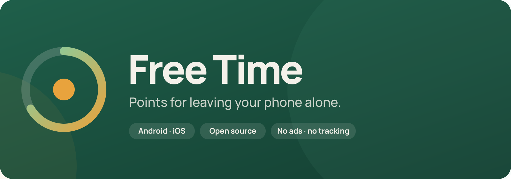
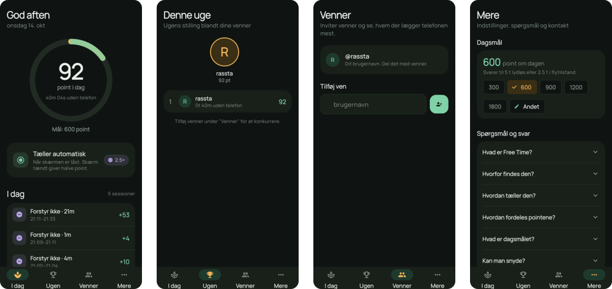

 

### The app that rewards you for *not* using it.

Points for leaving your phone alone. 
Silent beats sound. Airplane mode beats silent. Off beats everything. 
An anti-screen-time game for you and your friends.

 

 

 

## Why

The phone has become a guest that never goes home. It sits on the table at dinner, it comes to bed, it interrupts conversations, and it eats the small pauses where your mind would otherwise wander.

Free Time turns that around. Instead of measuring how much you use your phone, it rewards the time you don't. No blocking, no nagging, no streak-shaming. Just a small, friendly score for being present, and a leaderboard to make it a game with the people you care about.

Put it down. Score.

## How it works

1. **Put your phone down.** Lock it, and the counter starts.
2. **Pick it up.** Unlock it, and the counter stops.
3. **Earn points** for every minute in between. More for every step further away the phone is.
4. **Compare** your week with your friends.

On Android everything happens automatically in the background. On iPhone you start and stop a session with one tap. [See why.](#iphone)

## Points

You get **1 point per minute** the phone lies still, multiplied by how "gone" it is:

| Your phone is…              | Multiplier |
|-----------------------------|:----------:|
| On, sound on                | 1×         |
| On vibrate                  | 1.5×       |
| On silent                   | 2×         |
| In Do Not Disturb / Focus   | 2.5×       |
| In airplane mode            | 4×         |
| Turned off                  | 6×         |
| Restarted                   | +50 bonus  |

Two things halve your points: lying with the **screen on** (but locked), and being **carried around** in a pocket instead of lying still. Multipliers stack, so silent in your pocket is 2 × 0.5 = 1×.

**Examples.** An hour on silent on the table is 120 points. An hour in airplane mode is 240. A night turned off is roughly 2,900.

Set your own daily goal in the app. The default is 600, about five hours on silent or two and a half in airplane mode.

## Friends

Add friends by username and see the week's standings. Your friends see your weekly points and total time away from the phone, never your individual sessions.

## Privacy

Free Time stores the minimum needed to compute a score:

- when a session started and ended
- which state the phone was in (sound, silent, airplane, off)
- whether it lay still and whether the screen was on

It does **not** see which apps you use, who you talk to, or where you are. There are no ads, no analytics SDKs, and nothing is sold. The code is open, so you can check.

Your account is just an email address. You log in with a link, there is no password.

## Install on Android

**Option A, Obtainium (recommended).** Get updates automatically.

1. Install [Obtainium](https://github.com/ImranR98/Obtainium/releases/latest).
2. Add an app and paste `https://github.com/rallevondalle/free-time`.
3. Install. New versions show up in Obtainium when they are released.

**Option B, APK.** Download the latest APK from [Releases](../../releases/latest) and open it.

On first launch, allow the app to run in the background. Android would otherwise kill the counter after a while. The small permanent notification is required by Android for background services. It never makes a sound.

Works on GrapheneOS and other de-Googled devices. No Play Services needed.

## iPhone

The iOS version is in development. Apple does not let apps read the silent switch, airplane mode, or whether the phone is locked, and apps may not run in the background for hours. So on iPhone you tap **"Put the phone down"** when you put it down and **"Stop"** when you pick it up. The app then checks with the phone's motion history and Screen Time whether it actually lay still and went unused.

## Questions

Read the [FAQ](docs/FAQ.md) (also [in Danish](docs/FAQ.da.md)) or write to **freetime@rassta.dk**.

 

<b>For developers</b>

 

Free Time is a Flutter app with native measurement layers and a Supabase backend.

| Part | Where | What |
|---|---|---|
| App UI | `lib/` | Flutter / Dart |
| Android tracker | `android/app/src/main/kotlin/` | Always-on foreground service, shutdown/boot receivers |
| iOS bridge | `ios/Runner/FreeTimeBridge.swift` | CoreMotion history, DeviceActivity, Focus, boot time |
| Backend | `supabase/` | Postgres schema, server-side scoring, RLS, leaderboard |

**Build (Android):** `mise install`, then `flutter run --dart-define-from-file=dart_defines.json` with `SUPABASE_URL` and `SUPABASE_KEY` in that file.

**Build (iOS):** see [docs/ios-setup.md](docs/ios-setup.md).

**Backend:** `supabase link` and `supabase db push`. Scoring rules live in the `scoring_rules` table and can be tuned without an app release.

**Release:** push a tag like `v0.2.0`. GitHub Actions builds a signed APK and attaches it to a release.

More: [scope and design decisions](docs/scope.md), [brand](docs/brand.md).

